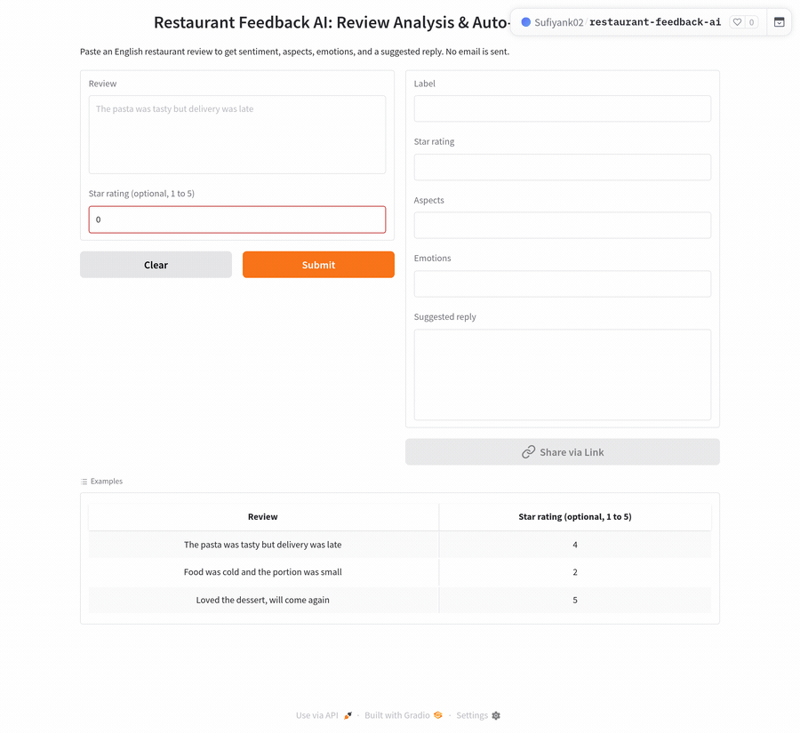

# Restaurant Feedback AI

[](https://huggingface.co/spaces/Sufiyank02/restaurant-feedback-ai)
[](https://huggingface.co/Sufiyank02/restaurant-feedback-model)
[](LICENSE)
[](https://www.python.org/)
[](https://fastapi.tiangolo.com/)

Analyse English restaurant reviews and draft a reply in one step.

It predicts sentiment, finds aspects such as taste or delivery, tags emotions, blends in an optional star rating, and writes a suggested reply. The API can also build insights across many reviews.



**Live demo:** [Hugging Face Space](https://huggingface.co/spaces/Sufiyank02/restaurant-feedback-ai)

**Model:** [Sufiyank02/restaurant-feedback-model](https://huggingface.co/Sufiyank02/restaurant-feedback-model)

The public Space is an interactive demo. This GitHub repo is the full FastAPI app (docs, `/analyze`, templates, and optional email). You can run it locally or with Docker.

## Features

- Sentiment labels: positive, neutral, or negative
- Aspect detection: taste, delivery, packaging, quantity, price, service, ambience, hygiene
- Emotion tags such as joy, sadness, anger, or anticipation
- Optional 1 to 5 star rating blended with the text score
- Auto-generated English reply, with a regenerate option
- Insights dashboard across a batch of reviews
- 19 built-in email templates, plus create, edit, preview, and send
- Public demo that needs no API key and never sends email
- API key auth on the API routes
- Works with English reviews

## How it works

The trained model is a word and character TF-IDF `FeatureUnion` plus Logistic Regression. A second Logistic Regression meta-model stacks those class probabilities with VADER scores and review length.

The API then:

1. Cleans the text the same way as training (slang, contractions, emoji).
2. Predicts a text label, with optional bias correction.
3. Blends in an optional star rating.
4. Detects aspects from keywords and sentence sentiment.
5. Tags emotions with NRCLex.
6. Builds a draft reply with a template-style reply engine.
7. Recommends one of 19 email templates. Sending mail is optional and needs SMTP on your own host.

Holdout macro F1 for the classifier is 0.697, as recorded in `models/feedback-config.json`. It is a small classical model, so short, sarcastic, or mixed reviews can be wrong. The API flags some of those cases for manual review.

## Quick start

### Local

Python 3.13 is required so the pickle matches training (scikit-learn 1.8.0, numpy 2.3.5, joblib 1.5.2). The model files in `models/` are already in this repo (about 4.3 MB, not Git LFS).

```
python -m venv venv
source venv/bin/activate
pip install -r requirements.txt
python -m textblob.download_corpora
cp .env.example .env
# set API_KEY in .env
uvicorn app.main:app --reload
```

Open http://localhost:8000/demo for the UI, or http://localhost:8000/docs for the API. In `/docs`, use the Authorize button and paste your `API_KEY`.

### Docker

```
docker build -t restaurant-feedback-ai .
docker run --rm -p 8000:8000 -e API_KEY=change-this-to-a-long-secret-key restaurant-feedback-ai
```

Then open http://localhost:8000/demo or http://localhost:8000/docs.

## API endpoints

Header for all routes except `/`, `/demo`, `/health`, and `/docs`: `x-api-key: <your API_KEY>`

### Analysis

| Method | Path | What it does |
|---|---|---|
| GET | `/health` | Status, model info, SMTP status, template count |
| POST | `/analyze` | One review: label, aspects, emotions, admin suggestion, reply, recommended template, auto email |
| POST | `/analyze-batch` | Up to 100 reviews |
| POST | `/reply` | Regenerate reply (change `seed`) |
| POST | `/insights` | Dashboard summary of many reviews |

### Templates

| Method | Path | What it does |
|---|---|---|
| GET | `/templates` | List all templates (filter: `?category=negative&active_only=true`) |
| GET | `/templates/{id}` | One template |
| POST | `/templates` | Create a template |
| PUT | `/templates/{id}` | Edit a template |
| DELETE | `/templates/{id}` | Delete a template |
| POST | `/templates/{id}/preview` | Filled email (subject + body + html), nothing is sent |

### Email

| Method | Path | What it does |
|---|---|---|
| POST | `/send-email` | Send an email using a template ID (admin can override subject or body) |

**Analyze a review**

```json
{
  "text": "The pasta was great but delivery was late",
  "rating": 4,
  "customer_name": "Alex",
  "business_name": "Our Restaurant",
  "email": "customer@example.com"
}
```

The response includes `final_label`, `aspects`, `emotions`, `admin_suggestion`, `suggested_reply`, `recommended_template`, and `email_status` (`no_email`, `pending`, `sent`, `skipped`, `failed`).

## Environment variables

Only `API_KEY` is required for the API. The public demo does not need a key.

**Secret (required for the API)**

| Name | What it does | Example (not a real secret) |
|---|---|---|
| `API_KEY` | Auth for API routes | `change-this-to-a-long-secret-key` |

**Optional variables**

| Name | Default | What it does |
|---|---|---|
| `ALLOWED_ORIGINS` | `*` | CORS origins, comma-separated |
| `MODEL_DIR` | `models` | Folder with the pickle and config |
| `BUSINESS_NAME` | `Our Restaurant` | Name used in replies and templates |
| `TEMPLATES_FILE` | `data/templates.json` | Where edited templates are saved |
| `AUTO_SEND` | `false` | Auto-send email after `/analyze` when an address is given |
| `AUTO_SEND_LABELS` | `positive` | Labels that may be auto-sent |
| `DEFAULT_COUPON` | `THANKYOU10` | Fallback coupon placeholder |
| `REVIEW_LINK` | empty | Review link used in templates |
| `BUSINESS_PHONE` | empty | Phone used in urgent templates |

**Optional SMTP secrets**

`SMTP_HOST`, `SMTP_PORT` (default 587), `SMTP_USER`, `SMTP_PASSWORD`, `MAIL_FROM`, `MAIL_REPLY_TO`.

Hugging Face Spaces only allow outbound traffic on ports 80, 443, and 8080. SMTP ports 25, 465, and 587 are blocked there, so `/send-email` will time out on Spaces even if these are set. Leave them unset on the public demo. Without SMTP the API still works: `/send-email` returns 503, and auto email shows `skipped` or `pending`.

## Project structure

```
app/
  main.py              FastAPI app and routes
  analyzer.py          Cleaning, model, aspects, emotions
  replies.py           Draft reply and admin suggestion
  insights.py          Batch dashboard summary
  email_templates.py   19 built-in templates and storage
  mailer.py            Optional SMTP sending
  demo.py              Gradio UI mounted at /demo
models/
  feedback-model.pkl   Trained sklearn bundle
  feedback-config.json Cleaning maps, aspects, training metrics
tests/
  test-api.py
  test-email.py
assets/
  demo.gif
  demo.png
Dockerfile
requirements.txt
```

## Tests

Run these from the project root, with the virtual environment active:

```
python tests/test-api.py
python tests/test-email.py
```

The email tests do not send real mail. They capture outgoing messages in memory.

## Roadmap

- Predict the main problems a restaurant has (taste, delivery, service, price, hygiene) from all its reviews, so owners know what to fix first
- An HTTPS email provider (for example Resend or Brevo), so sending mail can work in places where SMTP ports are blocked

## License

This project is licensed under the MIT License. See `LICENSE` for the full text.

## Author

Kazi Sufiyan, AI Engineer.

- GitHub: [kazisufiyan-k2](https://github.com/kazisufiyan-k2)
- LinkedIn: [linkedin.com/in/kazisufiyan](https://www.linkedin.com/in/kazisufiyan/)
